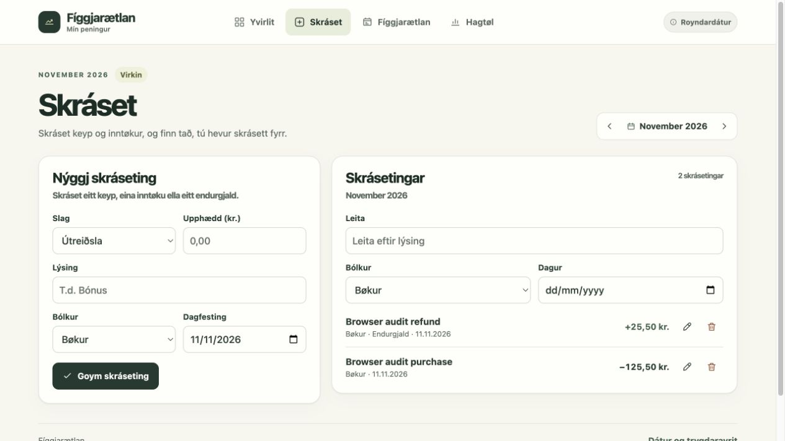

# Fíggjarætlan

Fíggjarætlan is a Faroese personal budgeting app for iPhone and Mac. It keeps a monthly spending plan alongside the purchases, refunds, and income recorded against it. The hosted version can be installed from Safari and syncs between devices.



## Try the demo

Download or clone this repository and open `index.html` in your browser. The demo starts with sample records and saves changes in that browser. It runs without an account or server.

## What it does

- Build monthly budgets for expected income, fixed costs, and variable expenses. Copy a previous month's plan without copying its transactions.
- Record expenses, refunds, and income. Find entries by description, date, or category. Category menus use Faroese alphabetical order.
- Explore monthly totals, category spending, and insights in **Hagtøl**. Choose a preset or a custom range and open the transactions behind each chart.
- Download transaction and budget CSVs or a JSON backup that can be restored in the app.
- Queue new transactions when offline and sync them on reconnection. Editing existing transactions or budgets in the hosted app requires a connection.

## How it works

The frontend uses HTML, CSS, and JavaScript. It stores amounts as integer øre. The hosted app uses a service worker to cache the app, IndexedDB for offline transactions, and a Cloudflare Worker with a D1 database. GitHub OAuth restricts the hosted ledger to one configured owner. The server rejects stale edits and identifies retried writes so the same transaction is recorded once.

## Build and test

Use Node.js 24 or newer.

```sh
npm ci
npm test
npm run test:runtime
npm run build
```

The tests cover budgeting and categories, statistics, exports and restore, sign-in, and offline sync. The runtime suite uses a temporary local D1 database. `npm run build` creates the hosted app bundle in `dist/`.

To host your own instance, copy `wrangler.example.jsonc` to `wrangler.jsonc` and fill in your Worker and D1 details. Apply the SQL migrations in `cloud/migrations/`. Register a GitHub OAuth app with a callback at `/auth/callback` on your Worker origin, and store `GITHUB_CLIENT_SECRET` as a Worker secret.
